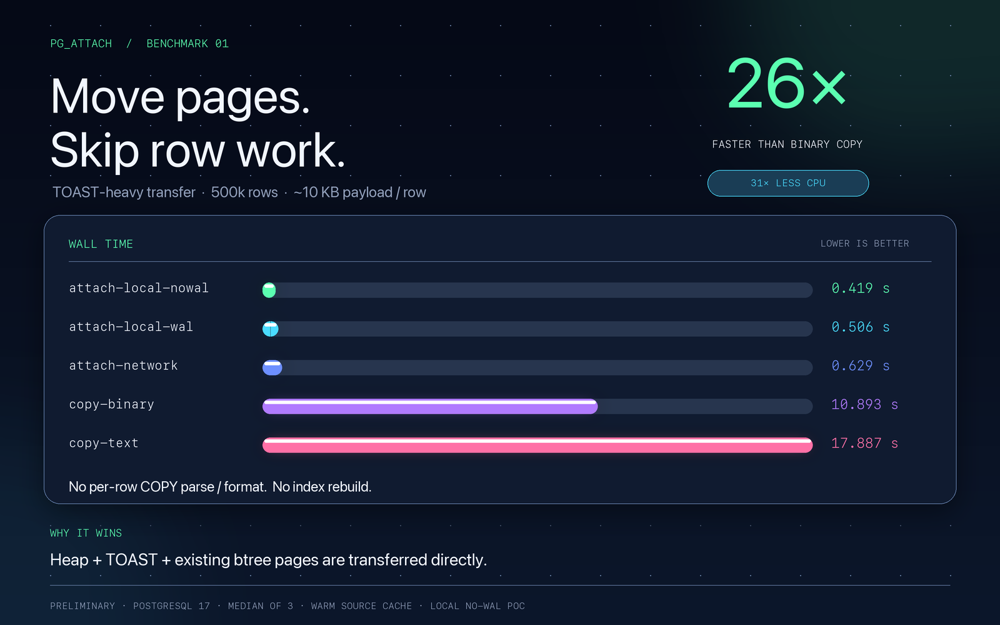
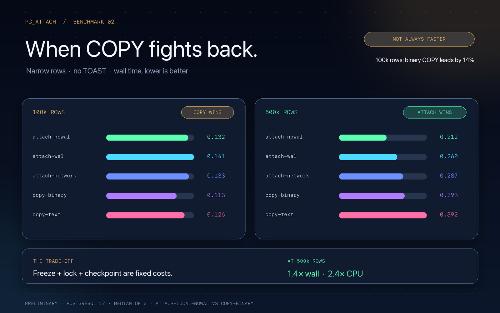

# pg_attach: как перенести таблицу PostgreSQL страницами, а не строками

`pg_attach` — это расширение PostgreSQL 16–18, которое клонирует таблицу вместе с
heap, TOAST и готовыми btree-индексами. Оно предназначено для случаев, когда
обычный `COPY` тратит слишком много времени на разбор и повторную сборку строк,
а `CREATE INDEX` затем заново строит индексы по всему содержимому таблицы.

Главная идея: **не превращать каждую строку в SQL или текст, а передать страницы
хранения и установить их в хранилище другой таблицы**. При этом pg_attach не
копирует файлы командой ОС и не переносит их буквально без изменений. Он читает
страницы через PostgreSQL SMGR, корректирует служебные поля и TOAST-указатели,
передаёт их собственным бинарным протоколом поверх `COPY` и записывает в новые
физические файлы target-отношений.

Проект находится в состоянии PoC. Это не универсальная замена репликации,
`pg_dump`, логического `COPY` или онлайн-миграции без блокировок.

## Для чего это можно использовать

Практические сценарии:

- быстрое клонирование большой таблицы в другую базу или на другой совместимый
  PostgreSQL-инстанс;
- создание локальной копии таблицы для экспериментов, отчётов, ETL или отладки;
- периодическое полное обновление аналитической/архивной таблицы, когда merge не
  нужен и destination можно полностью заменить;
- перенос TOAST-heavy данных — больших текстов, JSON и других varlena-значений,
  когда стоимость построчного преобразования особенно заметна;
- перенос таблицы с уже построенными btree-индексами без повторного полного
  `CREATE INDEX` по данным.

Особенно полезен pg_attach, когда выполняются три условия:

1. таблица большая;
2. в перенос входят внешние TOAST-данные или заметные btree-индексы;
3. источник можно заморозить и на время переноса заблокировать эксклюзивно.

Для маленькой таблицы с узкими строками и без TOAST выигрыш может отсутствовать:
фиксированная стоимость `VACUUM FREEZE`, lock и checkpoint способна оказаться
больше экономии на страницах.

## Два публичных сценария

На обоих инстансах должна быть установлена одинаковая сборка расширения:

```sql
CREATE EXTENSION pg_attach;
```

### Перенос между инстансами

Вызов выполняется на target. Именно target инициирует соединение и вытягивает
данные из source:

```sql
SELECT pg_attach_import(
  'host=source port=5432 dbname=postgres user=postgres',
  'public.events',
  'public.events_copy',
  true
);

VACUUM (ANALYZE) public.events_copy;
```

Аргументы:

- `source_conninfo` — строка подключения libpq;
- `source_table` — исходная таблица, в текущей реализации schema-qualified;
- `target_table` — существующая или новая таблица, имя может отличаться от
  исходного;
- `generate_wal` — нужно ли записывать full-page WAL для перенесённых страниц.

Если `public.events_copy` уже существует, её содержимое полностью заменяется.
Если таблицы нет, расширение попытается создать её по бинарному описанию схемы.
Это **overwrite, а не merge и не инкрементальная синхронизация**.

SQL-обёртка находится в `src/lib.rs:101`, основная реализация — в
`src/pg_attach/importer.rs:354`.

### Локальное клонирование в текущей базе

```sql
SELECT pg_attach_import_local(
  'public.events',
  'public.events_copy',
  true
);
```

Несмотря на название, это не отдельный упрощённый движок. `import_local`
проверяет, что source и target — разные таблицы, строит conninfo к собственному
postmaster через Unix socket и повторно вызывает обычный `import`
(`src/pg_attach/importer.rs:428`, `src/pg_attach/ffi.rs:13`).

То есть используются два backend одного PostgreSQL: один замораживает, блокирует
и экспортирует source, другой устанавливает страницы в target. Данные не уходят
на внешний сетевой инстанс, но libpq и binary COPY всё равно используются.

## Из чего состоит расширение

| Компонент | Роль |
| --- | --- |
| `src/lib.rs` | SQL API на pgrx и debug-GUC для тестов |
| `src/pg_attach/importer.rs` | target-side orchestration, создание/проверка target, установка страниц |
| `src/pg_attach/source_client.rs` | синхронный libpq-клиент, freeze/lock/checkpoint, чтение binary COPY |
| `src/pg_attach/exporter.rs` | schema descriptor, manifest и поток страниц на source |
| `src/pg_attach/wire.rs` | собственный бинарный формат заголовка и page packets |
| `src/pg_attach/ffi.rs` | безопасная граница между Rust и PostgreSQL/pgrx |
| `src/page_shim.c` | heap/tuple macros, TOAST rewrite, checksums, SMGR I/O и WAL |

Rust управляет протоколом и транзакционным сценарием. C нужен там, где важны
внутренние структуры PostgreSQL и макросы работы со страницами. Внешний фоновый
worker и `shared_preload_libraries` не требуются.

## Весь путь переноса одним взглядом

```text
SQL pg_attach_import
  │
  └─ importer::import
      ├─ SourceClient::connect                  PQconnectdb
      ├─ SourceClient::prepare_direct
      │   ├─ VACUUM (FREEZE)
      │   ├─ BEGIN + pg_attach_lock_source      ACCESS EXCLUSIVE
      │   ├─ pg_attach_source_is_frozen         VM / direct page validation
      │   └─ CHECKPOINT через второе соединение
      ├─ pg_attach_export_schema                бинарное описание схемы
      ├─ open_target / create_target            существующий или новый target
      ├─ COPY (SELECT pg_attach_export_stream)  binary COPY
      │   ├─ build_manifest                     список relations и blocks
      │   └─ next_page                          read → patch → encode
      │                                             │
      │                    libpq PQgetCopyData      │
      │                                             ▼
      │                              prepare_state → accept → write_page
      │
      ├─ ImportState::finish                    WAL full pages или fsync
      └─ source.commit                          снятие source lock
```

Дальше разберём каждую фазу.

## 1. Freeze: почему нельзя просто прочитать живые страницы

PostgreSQL хранит в heap-страницах версии строк. Чтобы физическая копия была
самостоятельно читаемой в другом кластере, переносимые tuples должны иметь
поддерживаемое frozen-состояние и не зависеть от текущей транзакционной истории
source.

Поэтому `SourceClient::prepare_direct`
(`src/pg_attach/source_client.rs:169`) выполняет цикл:

1. `VACUUM (FREEZE) schema.table` в autocommit;
2. `BEGIN`;
3. `SELECT pg_attach_lock_source(...)`;
4. `SELECT pg_attach_source_is_frozen(...)`;
5. `CHECKPOINT` через отдельное libpq-подключение.

`pg_attach_lock_source` открывает relation с `AccessExclusiveLock`
(`src/pg_attach/exporter.rs:417`). Блокировка удерживается до конца source
транзакции, включая экспорт схемы и весь page stream. В этот период блокируются
не только writers, но и другие обращения к таблице, включая читателей.

Это значит, что перенос **не является online-операцией без паузы обслуживания**.

### Гонка между VACUUM и LOCK

`VACUUM FREEZE` не запрещает DML. Writer может успеть изменить таблицу после
vacuum, но до получения `ACCESS EXCLUSIVE`. Поэтому проверка frozen-состояния
выполняется повторно уже под блокировкой.

Если изменение обнаружено, source делает `ROLLBACK`, снимает lock и повторяет
весь цикл. Лимит — три попытки (`MAX_ATTEMPTS = 3`). Это защита от бесконечного
повтора при постоянном потоке writers.

Writer, который пришёл уже после получения блокировки, ждёт завершения переноса;
его новая версия строки в копию не попадает.

Важно и то, что source не является строго read-only: `VACUUM FREEZE` меняет
физические tuple flags/VM и может создавать WAL. Роли source нужны права на
`VACUUM` таблицы и выполнение `CHECKPOINT`.

## 2. Проверка frozen-страниц через visibility map

Функция `source_is_frozen` (`src/pg_attach/exporter.rs:391`) сначала вызывает
`FlushRelationBuffers` для heap и TOAST. Это необходимо, потому что следующая
проверка читает страницы напрямую через SMGR, минуя buffer manager: dirty page в
shared buffers должна стать видимой direct read.

Затем `relation_is_frozen` (`src/pg_attach/exporter.rs:363`) проходит номера
блоков:

- если у страницы установлен `VISIBILITYMAP_ALL_FROZEN`, чтение data page для
  предварительной валидации пропускается;
- иначе вызываются `smgrread` и `pg_attach_heap_page_is_frozen`;
- C-проверка проходит tuples и требует `HeapTupleHeaderXminFrozen` и
  `HEAP_XMAX_INVALID` (`src/page_shim.c:58`).

VM здесь — оптимизация, а не окончательное доказательство корректности. Во время
streaming heap и TOAST снова проходят invariant-проверку в
`pg_attach_prepare_heap_page`. Поэтому legacy raw frozen xmin, который не
соответствует современным hint bits, будет отклонён даже при установленном VM
флаге.

После успешной проверки второе source-соединение выполняет `CHECKPOINT`.
Lock уже удерживается, поэтому новые dirty pages этой таблицы не могут появиться
между checkpoint и direct read. Checkpoint нужен ещё и для актуального состояния
индексных страниц; его стоимость относится ко всему source-кластеру, а не только
к переносимой таблице.

## 3. Описание схемы и подготовка target

До запуска page stream target получает результат `pg_attach_export_schema`.
Функция `export_schema` (`src/pg_attach/exporter.rs:115`) читает системный
каталог и кодирует компактный `TableSchema`:

- имена и типы колонок;
- collation, defaults, generated expressions и `NOT NULL`;
- dropped columns;
- поддерживаемые constraints;
- определения btree-индексов без привязки к исходным именам таблицы и индекса.

Это не `pg_dump` и не SQL-скрипт: по проводу передаётся бинарный descriptor с
magic `PGAS` и версией формата (`src/pg_attach/wire.rs:205`). Target декодирует
его в `SourceClient::schema`.

### Если target отсутствует

`create_target` (`src/pg_attach/importer.rs:61`):

1. при необходимости создаёт схему;
2. создаёт таблицу, колонки, defaults и constraints;
3. повторно удаляет dropped columns, чтобы сохранить физические attribute numbers;
4. создаёт btree-индексы на пока пустой таблице.

Последний пункт важен: сохранение dropped columns позволяет применить исходные
heap-страницы без перекладки tuple layout.

Auto-create отклоняет identity columns, foreign constraints и exclusion
constraints. Такой target можно попытаться подготовить явно, если его физическая
схема совместима. ACL, ownership, grants и roles не переносятся.

### Если target существует

`open_target` открывает heap, TOAST, TOAST index и пользовательские индексы под
`ACCESS EXCLUSIVE` (`src/pg_attach/importer.rs:299`). Затем `prepare_state`
сверяет manifest с target:

- target table name;
- режим checksums;
- точный список attributes: имена, type OID, collation OID, typmod, длина,
  `NOT NULL`, dropped-признаки;
- наличие TOAST и TOAST index;
- количество и формы btree-индексов.

Имена индексов могут отличаться, но их определения должны совпадать. Неожиданный
дополнительный индекс приводит к ошибке, а не молчаливому удалению.

## 4. Что именно переносится

`build_manifest` (`src/pg_attach/exporter.rs:7`) формирует упорядоченный список
отношений:

1. main heap;
2. TOAST heap, если он есть;
3. TOAST btree index;
4. пользовательские btree-индексы.

Для каждого relation сохраняются source OID, имя, тип и число блоков, а
записи manifest охватывают все переносимые форки: `MAIN`, `VM` и `FSM`
(последние — только если файл форка существует на source). VM и FSM копируются
после freeze-валидации и checkpoint, поэтому их состояние соответствует
переданным heap-страницам; статистика planner не переносится, поэтому после
импорта рекомендуется `VACUUM (ANALYZE)`.

Поддерживаются только permanent plain heap tables и валидные, ready, non-partial,
non-exclusion btree (`src/pg_attach/ffi.rs:156`, `src/pg_attach/ffi.rs:165`).

Перед приёмом страниц target вызывает `RelationSetNewRelfilenumber` для каждого
relation (`src/pg_attach/importer.rs:135`). Таким образом:

- OID таблицы и её catalog identity могут остаться прежними;
- старое физическое хранилище заменяется новым relfilenumber;
- имя target может отличаться от source;
- старые данные не смешиваются с новыми;
- при откате транзакции старое хранилище остаётся доступным.

Именно поэтому операция является транзакционным overwrite, а не редактированием
существующего файла на месте.

## 5. Бинарный page stream поверх COPY

Source запускает:

```sql
COPY (
  SELECT pg_attach_export_stream(
    'public.events',
    'public.events_copy',
    target_toast_oid,
    target_checksums
  )
) TO STDOUT (FORMAT binary);
```

Команда формируется в `src/pg_attach/importer.rs:370`. Set-returning function
возвращает по одному `bytea` на пакет, а `SourceClient::copy_out` читает их через
`PQgetCopyData`, снимает binary COPY envelope и передаёт payload importer'у
(`src/pg_attach/source_client.rs:239`).

Собственный протокол (`src/pg_attach/wire.rs`) содержит:

- первый пакет `PGAT`, версия 1 и manifest;
- page packet: `relation:u16`, `fork:u8`, flags, `block:u32`, `length:u32`;
- ровно 8192 байта page payload;
- терминатор из четырёх нулевых байтов.

В текущем протоколе размер страницы зафиксирован на 8 KiB. Временный staging-файл
не создаётся: страницы обрабатываются потоком, а память ограничена текущими
пакетами и небольшими буферами обработки.

Это и есть смысл выражения «перенос таблицы как файлов» на уровне идеи, но не
механики: файлы и сегменты не копируются по путям ОС. SMGR сам разрешает
relation locator, tablespace, forks, сегменты и block numbers.

## 6. Что изменяется в странице на source

`ExportState::next_page` (`src/pg_attach/exporter.rs:286`) для каждого блока:

1. открывает соответствующее relation;
2. читает страницу через `pg_attach_read_page` → `smgrread`
   (`src/page_shim.c:48`);
3. подготавливает её в C;
4. кодирует page packet и возвращает в COPY stream.

### Heap и TOAST

`pg_attach_prepare_heap_page` (`src/page_shim.c:141`):

- повторно проверяет frozen xmin и invalid xmax каждого нормального tuple;
- нормализует xmin в `FrozenTransactionId`, а xmax в `InvalidTransactionId`;
- очищает `pd_prune_xid`;
- при необходимости переписывает внешние TOAST pointers;
- выставляет page LSN и пересчитывает checksum.

Поэтому утверждение «pg_attach вообще не трогает строки» было бы неверным.
Полного преобразования каждой строки в текст/бинарный COPY tuple нет, но scan
tuple headers остаётся. Более того, для tuples с `HEAP_HASEXTERNAL` вызывается
`heap_deform_tuple`, чтобы найти varlena-указатели.

### Почему переписывается TOAST OID

Внешний TOAST pointer содержит OID TOAST-отношения. На source и target эти OID
разные. Если перенести указатель как есть, target heap будет ссылаться на
неправильное или несуществующее relation.

Код проверяет, что `va_toastrelid` равен ожидаемому source TOAST OID, и заменяет
его на target TOAST OID (`src/page_shim.c:200-217`). Сами TOAST-страницы и
физическое расположение чанков сохраняются, поэтому продолжают работать ссылки
на их значения. Inline и compressed-inline значения не требуют такой замены.

### Btree

Для btree вызывается более короткий `pg_attach_prepare_page`: меняются общие
page metadata, LSN/prune/checksum, но готовая структура дерева не строится
заново. Это возможно, потому что heap block/offset layout сохраняется, а target
индекс имеет совместимое определение.

В конце `pg_attach_finish_page` (`src/page_shim.c:81`) выставляет
`PageSetLSN(page, 1)`, обнуляет `pd_prune_xid` и пересчитывает либо обнуляет
checksum в зависимости от режима кластера.

## 7. Проверка и запись на target

Первый пакет инициализирует `ImportState`. Каждый следующий проходит
`ImportState::accept` (`src/pg_attach/importer.rs:221`):

- relation index должен существовать;
- поддерживается только main fork;
- блоки должны идти строго последовательно;
- номер блока не должен превышать длину из manifest;
- `pg_attach_verify_page` проверяет базовые page bounds и checksum, если она
  включена;
- только после этого страница записывается.

`pg_attach_write_page` (`src/page_shim.c:294`) использует:

- `smgrextend`, если блок добавляется в конец relation;
- `smgrwrite`, если блок уже существует;
- ошибку при попытке записать непоследовательный блок.

`ImportState::finish` проверяет, что для каждого relation получено ровно
ожидаемое число блоков. Ранний конец COPY, отсутствующий терминатор или лишний
пакет считаются ошибкой.

Target heap, TOAST и индексы остаются под `ACCESS EXCLUSIVE` до commit
вызывающей транзакции. Ошибка в середине потока откатывает создание новой таблицы
или замену relfilenumber существующей, поэтому partial data не должна становиться
видимым новым состоянием target.

## 8. WAL и durability

### `generate_wal = true`

После установки всех страниц `pg_attach_log_relation`
(`src/page_shim.c:321`) повторно читает их через SMGR и вызывает `log_newpages`
партиями. В WAL попадают full-page images heap, TOAST и индексов. Затем делается
`smgrimmedsync`.

Отдельный `XLogFlush` не нужен внутри этой функции: последующий commit target
транзакции сбрасывает и более ранние WAL-записи. Этот режим предназначен для
обычных permanent tables, physical replicas и PITR.

Цена — дополнительный проход чтения по установленным страницам и WAL объёмом
порядка перенесённых данных.

### `generate_wal = false`

Вместо `log_newpages` вызывается только `smgrimmedsync`
(`src/page_shim.c:367`). Это убирает page WAL, но не означает буквально нулевой
WAL для всей операции: обычные catalog/transaction записи PostgreSQL никуда не
исчезают.

Такой режим не позволяет физической реплике или WAL recovery восстановить
перенесённые страницы. Он подходит только для локального PoC без replicas/PITR и
не делает неподдерживаемый перенос безопасным.

## В чём выигрыш относительно COPY

Обычный путь `COPY + CREATE INDEX` выполняет примерно такую работу:

```text
read heap/TOAST
→ deform rows
→ encode values
→ transfer rows
→ decode values
→ form new tuples
→ insert heap/TOAST
→ scan target и построить каждый index
```

pg_attach заменяет его на:

```text
freeze + lock + checkpoint
→ read pages
→ проверить tuples / при необходимости заменить TOAST OID
→ transfer pages
→ verify + write pages
→ WAL full pages или fsync
```

Основная экономия:

- нет полного encode/decode значений каждой строки;
- нет повторного heap insert через обычный executor;
- нет полного построения пользовательских btree по содержимому target;
- при установленных VM-битах предварительная frozen validation не читает data
  pages повторно;
- передача и запись потоковые, staging-файл не нужен.

Но остаются:

- `VACUUM FREEZE` на source;
- эксклюзивная блокировка на всё время переноса;
- cluster-wide checkpoint;
- scan heap/TOAST tuples и частичная работа с varlena;
- запись всего объёма страниц на target;
- full-page WAL и повторное чтение страниц в WAL-режиме.

Следовательно, выигрыш прежде всего связан с удалением **построчной
CPU-работы и index rebuild**, а не с волшебным уменьшением объёма хранения.

## Предварительные измерения

В опубликованном PG17-прогоне для TOAST-heavy таблицы на 500k строк со значениями
около 10 KB получены такие медианы:

| Метод | Wall time | CPU |
| --- | ---: | ---: |
| attach local, no page WAL | 0.419 s | 0.403 s |
| attach local, WAL | 0.506 s | 0.484 s |
| attach через libpq | 0.629 s | 0.587 s |
| binary COPY + indexes | 10.893 s | 12.606 s |
| text COPY + indexes | 17.887 s | 22.955 s |

Из этих чисел получаются примерно 26× против binary COPY и 43× против text COPY
по wall time. Но для узких таблиц без TOAST на 100k строк binary COPY в том же
отчёте быстрее: 0.113 s против 0.132 s у local no-WAL attach.





К этим цифрам нужно относиться как к предварительным, а не как к гарантированному
ускорению. Прогон выполнен на одном Docker Desktop с тёплым source cache, без
реальной сети; cgroup I/O на такой конфигурации не отражает все записи. Кроме
того, перед использованием чисел как внешнего performance claim нужно повторить
замер после выравнивания post-processing методов и границ measurement window.
Абсолютные значения на другом оборудовании будут другими.

## Ограничения и эксплуатационные требования

Перед использованием нужно проверить весь список:

- PostgreSQL 16, 17 или 18; одинаковая major на source и target;
- одинаковая сборка расширения;
- совместимые architecture, encoding и physical layout;
- страницы 8 KiB в текущем wire protocol;
- одинаковый `data_checksums` — это явно проверяется manifest;
- plain logged heap table;
- только поддерживаемые btree-индексы;
- совпадение физических attributes и type/collation OID;
- source role может делать `VACUUM FREEZE` и `CHECKPOINT`;
- допустима `ACCESS EXCLUSIVE` на время freeze-validate-stream;
- для auto-create нет identity, foreign и exclusion constraints;
- не требуется перенос ACL, ownership, grants, roles или statistics
  (VM/FSM переносятся вместе с relation);
- для replicas/PITR используется `generate_wal = true`.

Часть требований проверяется кодом, но не все. Например, совместимость major,
архитектуры и encoding должен гарантировать оператор: manifest не является
универсальным валидатором всех свойств двух кластеров.

Не подходят partitioned/foreign/unlogged tables, cross-major upgrades, merge,
инкрементальная репликация и миграция без блокировки. Для них нужны другие
инструменты.

## Насколько это проверено

BDD-suite поднимает два отдельных postmaster и проверяет не только успешный
перенос, но и физические предусловия и отказы:

- heap, внешний TOAST, NULL, dropped columns и btree lookup;
- overwrite и auto-create;
- checksums on/off и WAL/no-WAL;
- rollback после ошибки поздней страницы;
- bounded retry после writer между vacuum и lock;
- VM fast path и fallback к чтению страниц;
- восстановление WAL full-page images после crash;
- отклонение legacy frozen tuple representation.

Это хорошее покрытие PoC, но оно не отменяет ограниченную матрицу типов, малый
объём unit-тестов протокола и необходимость дополнительных нагрузочных,
segment-boundary и recovery-проверок перед production-применением.

## Итог

`pg_attach` — это специализированный физический клонировщик таблиц для строго
совместимых PostgreSQL-кластеров. Он не пытается быть универсальным логическим
переносом: вместо этого сохраняет heap/TOAST/btree layout и платит за это freeze,
locks, checkpoint и жёсткими требованиями совместимости.

Его место — большие таблицы, особенно с внешним TOAST и готовыми btree, когда
нужна полная одноразовая копия и допустима эксклюзивная пауза на source. В таком
случае устранение построчного COPY и повторного index build может дать большой
выигрыш. Для маленьких таблиц, узких строк, живых систем без lock window или
несовместимых кластеров обычные инструменты PostgreSQL остаются более подходящим
выбором.
